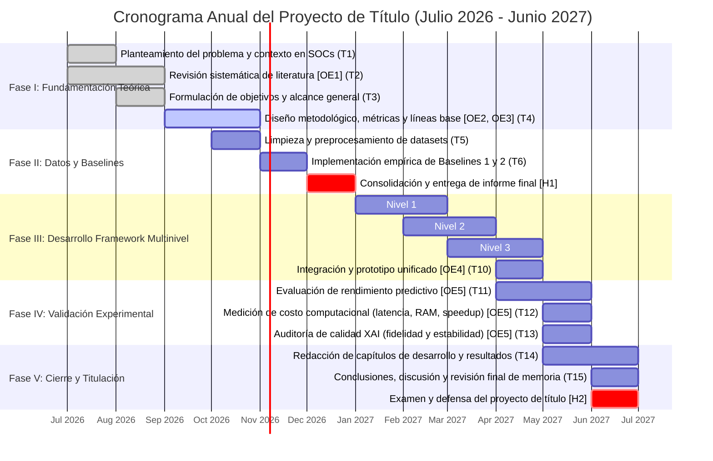
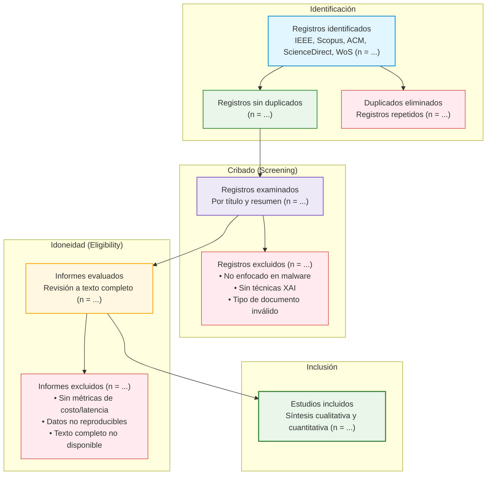
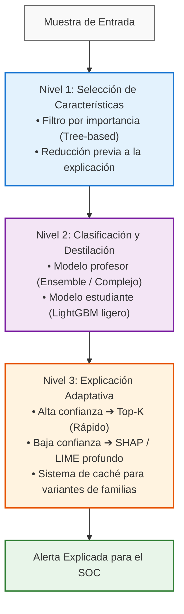

# INTELIGENCIA ARTIFICIAL EXPLICABLE (XAI) PARA LA CLASIFICACIÓN DE MALWARE

> [!INFO] **Metadatos del Documento**
> * **Tipo de Documento:** Informe de Avance de Seminario de Título
> * **Carrera:** Ingeniería en Informática
> * **Institución:** [[Pontificia Universidad Católica de Valparaíso]] — Escuela de Ingeniería Informática
> * **Autores:** Rigoberto Ignacio Enrique Canales Puebla & Francisco Ignacio Espinoza Vasquez
> * **Profesor Guía:** Pamela Hermosilla Monckton
> * **Profesor Correferente:** Sebastian Berrios Vasquez
> * **Fecha de Entrega:** 11 de Septiembre de 2026

---

## RESUMEN

Aunque los modelos de [[Machine Learning]] (ML) y [[Deep Learning]] (DL) logran altos niveles de precisión al clasificar malware, su adopción en operaciones reales de ciberseguridad se ve frenada por su naturaleza de «caja negra». Para los equipos de respuesta a incidentes, comprender el motivo exacto de una alerta es tan necesario como detectarla. Herramientas de [[Inteligencia Artificial Explicable (XAI)]] como [[SHAP]] y [[LIME]] aportan la transparencia requerida, pero introducen una sobrecarga de procesamiento severa. En la práctica, la complejidad algorítmica de métodos como KernelSHAP provoca cuellos de botella que impiden su uso en Centros de Operaciones de Seguridad (SOC), donde se deben analizar miles de muestras de alta dimensionalidad en tiempo real.

Para abordar este problema, esta investigación propone y valida un *framework* multinivel diseñado para reducir el [[Costo Computacional de XAI]] en la detección de malware. Tras realizar una revisión sistemática de la literatura y constatar la falta de soluciones enfocadas en la escalabilidad de estas explicaciones, se estructuró una arquitectura basada en tres ejes: primero, una selección de características para disminuir la dimensionalidad de los datos antes de la fase de explicación; segundo, el uso de destilación de conocimiento para transferir el aprendizaje hacia modelos intrínsecamente más ligeros; y finalmente, un mecanismo de explicación adaptativa que reserve las técnicas de XAI más costosas exclusivamente para las clasificaciones con baja confianza. Con este diseño se espera lograr una disminución sustancial en la sobrecarga de cómputo y en los tiempos de respuesta, preservando tanto la precisión de detección del sistema como la utilidad de los reportes entregados al analista.

**Palabras clave:** inteligencia artificial explicable, clasificación de malware, optimización computacional, SHAP, LIME, destilación de conocimiento, explicación adaptativa, ciberseguridad.

---

## ABSTRACT

Malware classification systems based on Machine Learning (ML) and Deep Learning (DL) have achieved exceptional accuracy, vastly outperforming traditional signature-based approaches. However, the opaque or "black-box" nature of these models hinders their adoption in critical cybersecurity environments, where understanding the causal justification of an alert is an unavoidable operational requirement. While Explainable Artificial Intelligence (XAI) addresses this challenge by providing transparency to predictions through techniques such as SHAP and LIME, its application introduces a restrictive computational cost. Methods like KernelSHAP exhibit high algorithmic complexity that generates systemic bottlenecks, rendering their integration unfeasible in Security Operations Centers (SOCs) that require real-time detection against thousands of daily samples with high dimensionality.

To address this problem, this research proposes the design and validation of a multi-level framework aimed at optimizing the computational cost of XAI in malware classification. Grounded in a systematic literature review that identified a structural gap regarding the scalability of explanations, the proposed architecture tackles the challenge through three combined approaches: intelligent feature selection to reduce pre-explanation dimensionality, knowledge distillation towards intrinsically lightweight models, and an adaptive explanation strategy based on confidence levels. Through this design, the framework is expected to substantially reduce computational overhead and response latency, without degrading detection accuracy or the analytical quality of the information delivered to security analysts.

**Keywords:** explainable artificial intelligence, malware classification, computational optimization, SHAP, LIME, knowledge distillation, adaptive explanation, cybersecurity.

---

## ÍNDICE GENERAL

1. [Introducción](#1-introducción)
2. [Definición del Problema](#2-definición-del-problema)
   - [Pregunta General de Investigación](#pregunta-general-de-investigación)
   - [Preguntas Específicas de Investigación](#preguntas-específicas-de-investigación)
3. [Plan de Trabajo](#3-plan-de-trabajo)
   - 3.1 [Desglose de Actividades y Entregables](#31-desglose-de-actividades-y-entregables)
4. [Marco Teórico](#4-marco-teórico)
   - 4.1 [Fundamentos de XAI](#41-fundamentos-de-xai)
     - 4.1.1 [Herramienta SHAP](#411-herramienta-shap)
     - 4.1.2 [Herramienta LIME](#412-herramienta-lime)
   - 4.2 [Tipos de Modelos de Clasificación y su Entrenamiento](#42-tipos-de-modelos-de-clasificación-y-su-entrenamiento)
     - 4.2.1 [Justificación de las herramientas de explicabilidad](#421-justificación-de-las-herramientas-de-explicabilidad)
   - 4.3 [Estado del Arte de XAI aplicado a Malware](#43-estado-del-arte-de-xai-aplicado-a-malware)
     - 4.3.1 [Protocolo de Revisión Sistemática (PRISMA)](#431-protocolo-de-revisión-sistemática-prisma)
     - 4.3.2 [Análisis Comparativo de Trabajos Relacionados](#432-análisis-comparativo-de-trabajos-relacionados)
     - 4.3.3 [Identificación de Brechas y Oportunidades de Mejora](#433-identificación-de-brechas-y-oportunidades-de-mejora)
5. [Objetivos](#5-objetivos)
   - 5.1 [Objetivos Generales](#51-objetivos-generales)
   - 5.2 [Objetivos Específicos](#52-objetivos-específicos)
6. [Metodología](#6-metodología)
   - 6.1 [Enfoque y Diseño Experimental](#61-enfoque-y-diseño-experimental)
   - 6.2 [Fuentes de Datos y Preprocesamiento](#62-fuentes-de-datos-y-preprocesamiento)
     - 6.2.1 [Procedimiento de preparación de datos](#621-procedimiento-de-preparación-de-datos)
   - 6.3 [Justificación de Decisiones de Diseño](#63-justificación-de-decisiones-de-diseño)
   - 6.4 [Fases de Desarrollo del Framework](#64-fases-de-desarrollo-del-framework)
     - 6.4.1 [Reducción de Dimensionalidad Previa a la Explicación](#641-reducción-de-dimensionalidad-previa-a-la-explicación)
     - 6.4.2 [Clasificación con Destilación de Conocimiento](#642-clasificación-con-destilación-de-conocimiento)
     - 6.4.3 [Explicabilidad Adaptativa y Manejo de Incertidumbre](#643-explicabilidad-adaptativa-y-manejo-de-incertidumbre)
   - 6.5 [Métricas de Evaluación](#65-métricas-de-evaluación)
     - 6.5.1 [Rendimiento del Clasificador](#651-rendimiento-del-clasificador)
     - 6.5.2 [Costo y Eficiencia Computacional](#652-costo-y-eficiencia-computacional)
     - 6.5.3 [Calidad de las Explicaciones](#653-calidad-de-las-explicaciones)
   - 6.6 [Baselines y Escenarios de Comparación](#66-baselines-y-escenarios-de-comparación)
   - 6.7 [Entorno de Ejecución y Herramientas](#67-entorno-de-ejecución-y-herramientas)
7. [Resultados](#7-resultados)
   - 7.1 [Descripción de los experimentos](#71-descripción-de-los-experimentos)
8. [Conclusión](#8-conclusión)
- [Referencias Bibliográficas](#referencias-bibliográficas)

### Lista de Figuras
- **Figura 3.1:** Cronograma anual del proyecto y estado de avance
- **Figura 4.1:** Diagrama de flujo PRISMA del proceso de selección
- **Figura 6.1:** Arquitectura multinivel del framework propuesto

### Lista de Tablas
- **Tabla 3.1:** Desglose de actividades del Semestre I correspondiente al Seminario de Título
- **Tabla 3.2:** Desglose de actividades del Semestre II correspondiente al Trabajo Final de Título
- **Tabla 4.1:** Análisis comparativo de trabajos relacionados sobre clasificación de malware
- **Tabla 6.1:** Etapas secuenciales del flujo metodológico de la investigación
- **Tabla 6.2:** Justificación técnica de los componentes integrados en la arquitectura propuesta
- **Tabla 6.3:** Esquema operativo de umbrales de confianza para la explicabilidad adaptativa
- **Tabla 6.4:** Configuración de los escenarios base para la evaluación experimental

---

## 1. INTRODUCCIÓN

El constante crecimiento de las redes y servicios digitales ha ampliado las oportunidades para los ciberataques. Hoy en día, el malware evoluciona rápidamente y utiliza técnicas de evasión o polimorfismo que suelen superar a los antivirus tradicionales basados en firmas estáticas. Para enfrentar esta situación, la industria de la ciberseguridad se ha apoyado fuertemente en modelos de [[Machine Learning]] (ML) y [[Deep Learning]] (DL). Al entrenarse con datos históricos, estos sistemas logran detectar patrones de comportamiento complejos y son capaces de identificar amenazas nuevas (ataques *zero-day*) con niveles de precisión que a menudo superan el 99%.

A pesar de sus buenos resultados, llevar estos modelos a un entorno de producción presenta un obstáculo importante: operan como una «caja negra». Para los analistas de un Centro de Operaciones de Seguridad (SOC), saber que un archivo es malicioso no basta; necesitan entender por qué el modelo tomó esa decisión. Si el sistema no puede justificar sus alertas, el equipo de respuesta pierde confianza en la herramienta y se dificultan tareas clave como investigar el origen de la amenaza, contener el ataque o cumplir con auditorías técnicas.

Para aportar esta transparencia, la investigación actual ha adoptado la [[Inteligencia Artificial Explicable (XAI)]]. Técnicas como [[SHAP]] y [[LIME]] se han vuelto estándares porque permiten calcular qué peso tuvo cada variable (*feature*) en la predicción final. Sin embargo, aplicar estos métodos en la detección de malware genera un nuevo problema logístico: el costo de procesamiento es demasiado alto.

Algoritmos como KernelSHAP tienen una complejidad computacional exponencial respecto a la cantidad de variables analizadas ($\mathcal{O}(2^n)$). Por su parte, LIME necesita generar y predecir miles de variaciones de datos por cada archivo sospechoso. Si consideramos que analizar malware moderno implica procesar miles de características por archivo (como llamadas a la API de Windows o secuencias de bytes) y que un SOC evalúa cientos de miles de alertas diarias, el tiempo de cálculo que exige XAI genera un cuello de botella que frena la detección en tiempo real.

Al revisar la literatura científica, notamos que la gran mayoría de los estudios se enfocan en mejorar la precisión de los modelos o en probar que las herramientas XAI efectivamente funcionan, pero dejan de lado el problema del consumo de recursos. Salvo excepciones puntuales, como aplicar versiones más rápidas de SHAP a ciertos tipos de árboles de decisión, hace falta un enfoque que logre equilibrar explicaciones detalladas con las exigencias de velocidad que requiere el monitoreo en vivo.

Para abordar esta limitación, este trabajo propone diseñar, desarrollar y validar un *framework* multinivel pensado para optimizar el costo computacional de XAI en la [[Clasificación de Malware]]. La arquitectura se basa en tres pilares:
1. Primero, aplicar **selección de características** para achicar la dimensionalidad de los datos antes de generar la explicación;
2. Segundo, utilizar **destilación de conocimiento** para crear modelos más livianos y rápidos de interpretar;
3. Y tercero, incorporar un **sistema de explicación adaptativa**. Esta última técnica guarda los cálculos de XAI más pesados solo para aquellas detecciones donde el modelo tiene un bajo nivel de confianza, despachando el tráfico evidente con explicaciones computacionalmente más simples.

A través de este enfoque, el proyecto busca demostrar que es posible bajar drásticamente la carga computacional asociada a explicar el malware, sin sacrificar la precisión de la detección ni la utilidad de los reportes. El objetivo final es aportar una solución técnica que acerque el uso de modelos transparentes a la realidad operativa de los equipos de ciberseguridad.

---

## 2. DEFINICIÓN DEL PROBLEMA

Los modelos basados en [[Machine Learning]] y [[Deep Learning]] han demostrado un alto rendimiento en la detección automatizada de malware. Sin embargo, su adopción en operaciones reales de ciberseguridad se ve limitada porque operan esencialmente como «cajas negras», ocultando los motivos detrás de sus decisiones. Para un analista en un Centro de Operaciones de Seguridad (SOC), una simple alerta de clasificación no es suficiente: antes de aislar un equipo o activar protocolos de contención, se requiere comprender qué características del archivo sospechoso motivaron la detección y extraer Indicadores de Compromiso (IoC) útiles para mitigar la amenaza.

Para resolver esta falta de transparencia, se recurre a técnicas de [[Inteligencia Artificial Explicable (XAI)]] como [[SHAP]] y [[LIME]]. No obstante, su implementación en escenarios reales presenta un importante desafío de ingeniería: el **alto costo computacional**. Algoritmos como KernelSHAP poseen una complejidad que escala exponencialmente con la cantidad de variables analizadas, mientras que LIME requiere evaluar miles de perturbaciones por cada archivo sospechoso. En un entorno de producción, donde se inspeccionan miles de eventos diarios con cientos o miles de características por binario (como cabeceras PE o llamadas a la API), calcular estas explicaciones en cada predicción genera un cuello de botella que impide responder en tiempo real.

El problema central de esta investigación radica, por lo tanto, en la **tensión operativa entre la necesidad de contar con modelos transparentes y el costo computacional que exigen las herramientas de explicabilidad**. Surge así la necesidad de diseñar un *framework* que optimice el uso de estos recursos de cómputo, logrando explicaciones oportunas sin sacrificar la precisión del clasificador ni la fidelidad de la información técnica entregada al analista.

### Pregunta General de Investigación

> [!QUESTION] **Pregunta Principal**
> ¿En qué medida es posible reducir el costo computacional de las técnicas de Inteligencia Artificial Explicable (XAI) en la clasificación de malware mediante un enfoque multinivel que integre selección de características, destilación de conocimiento y explicabilidad adaptativa sin comprometer la precisión de la detección ni la fidelidad de las explicaciones?

### Preguntas Específicas de Investigación

1. ¿Cómo influye la reducción previa de dimensionalidad en la disminución de los tiempos de cálculo de algoritmos *post-hoc* como [[SHAP]] y [[LIME]] al analizar muestras de malware complejas?
2. ¿Es viable transferir el conocimiento de un ensamble clasificador complejo hacia un modelo más ligero mediante destilación, habilitando el uso de técnicas como TreeSHAP en tiempo polinomial sin degradar el rendimiento predictivo ($F_1$-Score)?
3. ¿En qué proporción un esquema de explicabilidad adaptativa basado en los niveles de confianza del modelo, junto a un mecanismo de caché, reduce el costo computacional promedio en flujos de trabajo continuos de monitoreo?

---

## 3. PLAN DE TRABAJO

El desarrollo de esta investigación se rige por una planificación cronológica estructurada que abarca los dos semestres lectivos exigidos para la titulación. A continuación se presenta el diagrama visual que detalla la distribución temporal de las fases del proyecto junto con su estado de avance actual.

### Figura 3.1: Cronograma anual del proyecto y estado de avance

---

### 3.1. Desglose de Actividades y Entregables

En las Tablas 3.1 y 3.2 se presenta la planificación detallada de las actividades que componen la investigación especificando el período de ejecución, su asociación con los objetivos específicos y los entregables verificables correspondientes.

#### Tabla 3.1: Desglose de actividades del Semestre I correspondiente al Seminario de Título

| ID | Actividad / Tarea | Período | Entregable Esperado | Estado |
|:---|:---|:---|:---|:---:|
| **Fase I** | **Fundamentación Teórica y Metodología** | | | |
| **T1** | Planteamiento del problema y contexto en SOCs | Jul 2026 | Capítulos 1 y 2 del informe | **Completada** |
| **T2** | Revisión sistemática de literatura [OE1] | Jul – Ago 2026 | Capítulo 3 Marco Teórico | **Completada** |
| **T3** | Formulación de objetivos y alcance general | Ago – Sep 2026 | Capítulo 4 Objetivos | **Completada** |
| **T4** | Diseño metodológico, métricas y líneas base [OE2, OE3] | Sep – Oct 2026 | Capítulo 5 Metodología | **En curso** |
| **Fase II** | **Datos y Líneas Base para Cierre de Seminario** | | | |
| **T5** | Limpieza y preprocesamiento de Datasets | Oct 2026 | Scripts de preparación y EDA | Planificada |
| **T6** | Implementación empírica de Baselines 1 y 2 | Nov 2026 | Benchmarks de referencia | Planificada |
| **H1** | **Consolidación y entrega de informe final** | **Dic 2026** | **Informe de Seminario de Título** | **Planificada** |

---

#### Tabla 3.2: Desglose de actividades del Semestre II correspondiente al Trabajo Final de Título

| ID | Actividad / Tarea | Período | Entregable Esperado | Estado |
|:---|:---|:---|:---|:---:|
| **Fase III** | **Desarrollo del Framework Multinivel** | | | |
| **T7** | Nivel 1: Selección de características con WOA y Tree [OE4] | Ene – Feb 2027 | Módulo de reducción dimensional | Planificada |
| **T8** | Nivel 2: Destilación de conocimiento desde Ensemble hacia LightGBM [OE4] | Feb – Mar 2027 | Clasificador destilado ligero | Planificada |
| **T9** | Nivel 3: Explicabilidad adaptativa y motor de caché [OE4] | Mar – Abr 2027 | Enrutamiento de alertas por certidumbre | Planificada |
| **T10** | Integración y ensamblado del prototipo unificado [OE4] | Abr 2027 | Prototipo de software ejecutable | Planificada |
| **Fase IV** | **Validación Experimental y Comparación** | | | |
| **T11** | Evaluación de rendimiento predictivo con Accuracy, F1 y AUC [OE5] | Abr – May 2027 | Matriz de confusión y curvas ROC | Planificada |
| **T12** | Medición de costo computacional evaluando latencia, RAM y speedup [OE5] | May 2027 | Reporte de eficiencia y recursos | Planificada |
| **T13** | Auditoría de calidad (XAI) para medir fidelidad y estabilidad [OE5] | May 2027 | Pruebas de perturbación (XAI) | Planificada |
| **Fase V** | **Cierre Redacción Final y Titulación** | | | |
| **T14** | Redacción de capítulos de Desarrollo y Resultados | May – Jun 2027 | Capítulos 6 y 7 del documento | Planificada |
| **T15** | Conclusiones, discusión y revisión final de memoria | Jun 2027 | Memoria de Título finalizada | Planificada |
| **H2** | **Examen y defensa del proyecto de título** | **Jun 2027** | **Presentación ante Comisión** | **Planificada** |

---

## 4. MARCO TEÓRICO

### 4.1. Fundamentos de XAI

La XAI sirve para solucionar el problema de los algoritmos predictivos que suelen funcionar de manera cerrada. En la ciberseguridad actual no basta con lograr una alta precisión al detectar un ataque. El especialista necesita entender los motivos técnicos detrás de esa decisión para actuar. Para esto la tecnología agrupa diversas herramientas diseñadas para dar transparencia a los modelos de aprendizaje automático. Esto ayuda a que los analistas puedan evaluar y respaldar las alertas del sistema con fundamentos claros en lugar de confiar ciegamente en un resultado matemático.

Estas herramientas se clasifican en dos grandes grupos según su enfoque y compatibilidad:
* **Por su alcance:** Pueden ser **globales** para analizar el comportamiento general frente a todos los datos, o **locales** para detallar los motivos de una alerta específica.
* **Por su compatibilidad:** Existen métodos diseñados para un solo tipo de algoritmo y métodos **agnósticos** que se logran adaptar a distintos modelos.

Para clasificar software malicioso se suelen preferir los métodos agnósticos que operan sobre modelos ya entrenados. Dentro de este grupo destacan las herramientas [[SHAP]] y [[LIME]].

#### 4.1.1. Herramienta SHAP
SHAP se basa en la teoría de juegos para asignar un valor de importancia a cada variable dentro de una predicción. Al calcular los **Valores de Shapley**, este método evalúa distintas combinaciones de los datos de entrada para medir cuánto aporta cada atributo a la detección. Su cualidad principal es que entrega una base matemática sólida que permite interpretar los resultados tanto a nivel local para un archivo en particular como a nivel global para entender qué define al malware en todo el conjunto analizado.

#### 4.1.2. Herramienta LIME
LIME busca explicar las decisiones de un modelo acercándose a un formato más simple y liviano que evalúa los datos directamente relacionados a la instancia analizada. Esta técnica altera de forma controlada los datos de entrada de la muestra sospechosa para observar cómo cambian los resultados del modelo original. Con esas variaciones logra generar una explicación rápida. Su ventaja principal suele ser el menor tiempo que toma en procesar justificaciones locales, lo cual resulta bastante útil para mantener la agilidad operativa dentro de un SOC.

---

### 4.2. Tipos de Modelos de Clasificación y su Entrenamiento

Para el desarrollo práctico de esta investigación se seleccionó una arquitectura de aprendizaje ensamblado conocida como **[[Stacking Ensemble]]** en lugar de utilizar redes neuronales profundas o algoritmos de clasificación individuales. La literatura científica indica que los modelos profundos alcanzan una alta exactitud pero suelen operar como modelos cerrados lo que dificulta auditar sus decisiones (Tayari & Zaied, 2026). Por otro lado los algoritmos predictivos tradicionales pueden presentar limitaciones frente a las nuevas técnicas de evasión del software malicioso.

El modelo ensamblado busca ofrecer una alternativa al combinar las predicciones de múltiples algoritmos base. Esta metodología colaborativa favorece un buen rendimiento predictivo para detectar amenazas complejas y al mismo tiempo mantiene una estructura que facilita la integración de herramientas externas de transparencia.

#### 4.2.1. Justificación de las herramientas de explicabilidad

Respecto a los mecanismos de interpretabilidad el proyecto integra las herramientas [[SHAP]] y [[LIME]] descartando alternativas como los mapas de activación visual o los mecanismos de atención interna. El motivo principal es que SHAP y LIME son técnicas agnósticas lo que permite adaptarlas a diversas arquitecturas de clasificación evaluando los resultados finales del algoritmo (Liu et al., 2025).

SHAP aporta una base matemática fundamentada para entender el comportamiento global del sistema mientras que LIME ofrece una mayor agilidad para analizar alertas de forma individual. El uso complementario de ambas estrategias tiene el propósito de entregar a los analistas de un SOC diferentes perspectivas técnicas para evaluar las advertencias del sistema de manera informada.

---

### 4.3. Estado del Arte de XAI aplicado a Malware

La literatura reciente demuestra múltiples esfuerzos para mejorar la detección de software malicioso utilizando técnicas avanzadas. Diversos estudios han explorado la transformación de archivos ejecutables en representaciones visuales para procesarlos mediante arquitecturas de aprendizaje profundo (Alshomrani et al., 2025; Ullah et al., 2022). Otros autores han logrado clasificar distintas familias de malware aplicando fusión multimodal (Alotaibi, 2025) o comparando el rendimiento predictivo al evaluar secuencias de llamadas a la interfaz de programación de aplicaciones (Cannarile et al., 2022).

En el entorno de los dispositivos móviles también se registran avances importantes enfocados en la ingeniería de características sobre grafos de llamadas a funciones (Kim et al., 2026). A nivel teórico la convergencia entre la explicabilidad computacional y la ciberseguridad sigue siendo un área de estudio expansiva y resulta fundamental para diseñar infraestructuras digitales más seguras y comprensibles para el ser humano (Cecchi et al., 2026).

#### 4.3.1. Protocolo de Revisión Sistemática (PRISMA)

Para fundamentar el estado del arte y garantizar la rigurosidad de la búsqueda se ejecutó una Revisión Sistemática de Literatura (SLR) orientada por los lineamientos PRISMA.

**Preguntas de Investigación (PI):** La exploración bibliográfica se guio por las siguientes interrogantes:
* **PI1:** ¿Qué técnicas de Inteligencia Artificial Explicable (XAI) se aplican actualmente en la clasificación de malware?
* **PI2:** ¿Cuáles son los cuellos de botella computacionales y las limitaciones operativas reportadas al implementar XAI en entornos de ciberseguridad?

**Estrategia de Búsqueda y Selección:** La recolección de datos abarcó las bases científicas IEEE, Scopus, ACM, ScienceDirect y Web of Science (WoS). El proceso empleó una cadena de búsqueda booleana que cruzó términos obligatorios sobre explicabilidad, software malicioso y las técnicas requeridas.
* **Criterios de inclusión:** Documentos clasificados como investigaciones originales para extraer metodologías de desarrollo práctico y revisiones bibliográficas para consolidar la base teórica.
* **Criterios de exclusión:** Formatos de extensión breve e investigaciones aplicadas a dominios ajenos a la clasificación de malware o que carecieran de métricas reproducibles de costo y latencia.

**Flujo de Selección:** El proceso metodológico consideró la eliminación de duplicados y dos fases de filtrado secuenciales. El flujo de descarte y el número de estudios primarios incluidos para la síntesis final se detallan visualmente en la Figura 4.1.

#### Figura 4.1: Diagrama de flujo PRISMA del proceso de selección

---

#### 4.3.2. Análisis Comparativo de Trabajos Relacionados

Para evidenciar de manera objetiva los vacíos tecnológicos actuales se estructuró una matriz comparativa con los estudios prácticos más relevantes identificados en la revisión sistemática. Esta evaluación cruza las variables operativas exigidas para justificar el diseño propuesto en esta investigación.

#### Tabla 4.1: Análisis comparativo de trabajos relacionados sobre clasificación de malware

| Estudio | Técnicas XAI | Modelos | Dataset | Métricas | Limitaciones |
|:---|:---|:---|:---|:---|:---|
| **Ullah et al.** | [[SHAP]] y [[LIME]] | [[Stacking Ensemble]] | Archivos ejecutables (PE) | Exactitud superior al 99% | Alto costo computacional para generar explicaciones continuas. |
| **Kim et al.** | Mapas de activación visual | Aprendizaje profundo sobre grafos | Ecosistema Android | Reducción de dimensionalidad con alta precisión predictiva | Convertir código a Grafos de Llamadas a Funciones (FCG) exige alto procesamiento. |
| **Alotaibi** | [[Mecanismos de Atención\|Mecanismos de atención interna]] | Fusión multimodal profunda | Características estáticas e imágenes | Alta exactitud en la identificación de familias de amenazas | Arquitectura de gran complejidad que opera como modelo de alto consumo. |

---

#### 4.3.3. Identificación de Brechas y Oportunidades de Mejora

El análisis de la literatura técnica expone ciertos vacíos estructurales que este trabajo propone abordar:
* **Exceso de complejidad:** Las arquitecturas profundas tienden a operar como modelos opacos de alto consumo. Para enfrentar esto el proyecto plantea evaluar un modelo ensamblado de estructura más directa.
* **Transformaciones de datos:** Convertir el código en imágenes o grafos requiere un procesamiento intensivo. El uso de información tabular basada en los encabezados de los archivos ejecutables (PE) representa una opción que exige menos recursos computacionales.
* **Costo computacional de la interpretabilidad:** Diversos autores de estudios referentes reportan que el cálculo constante de explicaciones matemáticas aumenta los tiempos de respuesta del sistema.

En base a estos antecedentes la investigación busca aplicar herramientas de transparencia al mismo tiempo que propone explorar técnicas de optimización. El propósito es evaluar la viabilidad real de integrar sistemas explicables en el flujo de trabajo diario de un SOC.

---

## 5. OBJETIVOS

### 5.1. Objetivos Generales

> Diseñar, construir y validar un *framework* multinivel para reducir el costo computacional de la [[Inteligencia Artificial Explicable (XAI)]] en la [[Clasificación de Malware]], con el fin de permitir el uso de modelos transparentes en operaciones de ciberseguridad que exigen respuestas rápidas.

### 5.2. Objetivos Específicos

Los objetivos de esta investigación se dividen en tres etapas metodológicas: el **Estudio**, **Desarrollo** y **Validación**, las cuales cubren desde la revisión del conocimiento actual hasta las pruebas experimentales del sistema.

#### Dimensión: Estudio

| ID | Objetivo Específico |
|:---|:---|
| **OE1** | Realizar una revisión sistemática de la literatura sobre el uso de XAI en la detección de malware para identificar los cuellos de botella computacionales y problemas de escalabilidad actuales. |
| **OE2** | Definir un marco de referencia que establezca cómo se medirá el costo computacional de XAI y la utilidad de las explicaciones en escenarios de monitoreo continuo. |

#### Dimensión: Desarrollo

| ID | Objetivo Específico |
|:---|:---|
| **OE3** | Diseñar la arquitectura del *framework* definiendo la interacción entre la reducción de dimensionalidad, la destilación de conocimiento y la estrategia de explicación adaptativa. |
| **OE4** | Construir un prototipo funcional que integre estos tres niveles asegurando su compatibilidad con clasificadores de malware y librerías estándar de explicabilidad. |

#### Dimensión: Validación

| ID | Objetivo Específico |
|:---|:---|
| **OE5** | Evaluar el sistema mediante experimentos sobre conjuntos de datos públicos para comprobar cuánta carga computacional se logra reducir frente a enfoques tradicionales sin sacrificar la precisión de la detección. |

---

## 6. METODOLOGÍA

Para cumplir con los objetivos planteados y abordar el cuello de botella computacional que presenta la XAI en este ámbito, se definió una metodología de carácter cuantitativo y experimental. El trabajo se estructura en una serie de etapas secuenciales que van desde la selección y tratamiento de los datos hasta el diseño y evaluación del *framework* de optimización.

#### Tabla 6.1: Etapas secuenciales del flujo metodológico de la investigación

| ETAPA 1 | ETAPA 2 | ETAPA 3 | ETAPA 4 |
|:---:|:---:|:---:|:---:|
| **Preprocesamiento y Datasets** | **Selección y Reducción (Dim.)** | **Entrenamiento y Destilación (ML)** | **Explicabilidad Adaptativa y Valid.** |

---

### 6.1. Enfoque y Diseño Experimental

La investigación sigue un **diseño experimental comparativo**. La meta no es únicamente medir la capacidad de detección del malware (evaluada mediante métricas tradicionales de clasificación), sino contrastar de forma empírica el [[Costo Computacional de XAI]] (tiempo de ejecución y memoria) y la fidelidad de las explicaciones generadas entre un enfoque XAI tradicional y el *framework* optimizado propuesto.

---

### 6.2. Fuentes de Datos y Preprocesamiento

Para validar el comportamiento del sistema frente a distintos tipos de amenazas y estructuras de datos, se seleccionaron dos conjuntos de datos públicos ampliamente utilizados en la literatura:

* **[[CICMalDroid]] 2020:** Dataset enfocado en el ecosistema Android con más de 17.000 muestras que abarcan cinco categorías principales (Adware, Banking, Ransomware, Riskware y Benigno). Proporciona características derivadas de [[Análisis Estático]] y [[Análisis Dinámico]] (permisos, llamadas al sistema y comportamientos en ejecución).
* **[[ClaMP Dataset]]:** Dataset orientado al entorno Windows que analiza archivos ejecutables en formato PE (*Portable Executable*), estructurado en 68 características obtenidas de las cabeceras, tablas de importación y secciones del binario.

#### 6.2.1. Procedimiento de preparación de datos:

* **Limpieza y normalización:** Eliminación de registros duplicados, tratamiento de valores nulos e imputación cuando corresponda, junto con el escalamiento de variables numéricas para evitar sesgos en el entrenamiento.
* **Codificación:** Conversión de atributos categóricos mediante técnicas estándar (*One-Hot Encoding* o *Target Encoding* según la cardinalidad de la variable).
* **Partición de datos:** División estratificada de los datos en subconjuntos de entrenamiento (70%), validación (15%) y prueba (15%), preservando la proporción original de cada familia de malware.

---

### 6.3. Justificación de Decisiones de Diseño

El diseño de la arquitectura propuesta no obedece a una simple agregación de técnicas aisladas, sino a una respuesta de ingeniería estructurada para resolver la tensión operativa entre precisión predictiva, latencia de respuesta y costo de explicabilidad en un SOC. A continuación se justifica técnicamente cada decisión de diseño de forma encadenada:

1. **Selección Inteligente de Características**
   - *Motivación:* Los registros de malware actuales (cabeceras PE, llamadas al sistema y permisos) abarcan cientos o miles de variables. Métodos de atribución *post-hoc* como KernelSHAP exhiben una complejidad combinatoria de orden $\mathcal{O}(2^n)$, donde $n$ representa la cantidad de atributos evaluados.
   - *Decisión y Aporte:* Se introduce una reducción dimensional previa basada en importancia de variables y algoritmos de optimización. Esto permite acotar el espacio de cálculo de la explicabilidad antes de la inferencia, eliminando redundancias sin degradar la capacidad discriminativa del sistema.

2. **Stacking Ensemble como Modelo Profesor**
   - *Motivación:* Las técnicas de evasión y el polimorfismo del malware moderno demandan modelos con alta capacidad de generalización. La literatura reciente evidencia que los clasificadores individuales suelen presentar limitaciones frente a amenazas complejas, mientras que los ensambles apilados ([[Stacking Ensemble]]) alcanzan niveles de detección, en comparativa, más altos.
   - *Decisión y Aporte:* Se adopta un ensamble heterogéneo como modelo base o «profesor». Este componente establece el techo de rendimiento del proyecto; sin embargo, al estar conformado por múltiples capas de clasificadores, su auditoría directa mediante XAI resulta computacionalmente inviable para flujos continuos.

3. **Destilación de Conocimiento (Knowledge Distillation)**
   - *Motivación:* Calcular explicaciones SHAP o LIME evaluando repetidamente las perturbaciones a través de todos los submódulos de un ensamble apilado colapsa los tiempos de respuesta exigidos en ciberseguridad.
   - *Decisión y Aporte:* Mediante destilación de conocimiento, se transfieren las probabilidades y representaciones aprendidas por el ensamble hacia un modelo individual y ligero («estudiante»). Esta estrategia desacopla la complejidad intrínseca del clasificador del costo computacional de su interpretación.

4. **Adopción de LightGBM como Modelo Estudiante**
   - *Motivación:* Se requiere un clasificador que mantenga el rendimiento del modelo profesor en datos tabulares y que ofrezca compatibilidad directa con algoritmos de explicabilidad acelerados.
   - *Decisión y Aporte:* Se selecciona [[LightGBM]] debido a su bajo consumo de memoria y rápida inferencia en CPU. Fundamentalmente, esta elección permite emplear **TreeSHAP**, un algoritmo especializado que calcula valores de Shapley exactos en tiempo polinomial ($\mathcal{O}(TLD^2)$, con $T$ árboles, $L$ hojas y profundidad $D$), eliminando la necesidad de recurrir a muestreos exponenciales como los de KernelSHAP.

5. **Dualidad SHAP y LIME bajo un Esquema Adaptativo**
   - *Motivación:* En la práctica de un SOC, la gran mayoría de las muestras corresponden a tráfico legítimo o familias de malware claramente identificables. Generar explicaciones completas para cada evento satura la infraestructura analítica sin aportar valor operativo adicional.
   - *Decisión y Aporte:* Se implementa un esquema condicionado por la certidumbre de la predicción ($P(\hat{y})$) y asistido por caché vectorial. Para detecciones con alta confianza ($P \ge 0.95$), se despacha una explicación ligera (*Top-K features*); mientras que las muestras en zona de incertidumbre ($P < 0.80$) reciben una auditoría en profundidad combinando la robustez global de SHAP con la aproximación local de LIME.

#### Tabla 6.2: Justificación técnica de los componentes integrados en la arquitectura propuesta

| Componente | Decisión Técnica | Aporte al Framework |
|:---|:---|:---|
| **Selección de Features** | Filtro previo por importancia | Reduce el espacio combinatorio antes de aplicar XAI y elimina ruido. |
| **[[Stacking Ensemble]]** | Clasificador heterogéneo apilado | Maximiza la detección frente a malware polimórfico (Modelo Profesor). |
| **Knowledge Distillation** | Transferencia de aprendizaje a modelo compacto | Desacopla la exactitud del clasificador del costo de su explicación. |
| **[[LightGBM]] (Estudiante)** | Modelo de árboles por gradiente | Permite inferencia rápida y cálculo de TreeSHAP en tiempo polinomial. |
| **SHAP + LIME Adaptativo** | Explicabilidad por niveles de confianza y caché | Optimiza el consumo de recursos al evitar cálculos exhaustivos en eventos evidentes. |

---

### 6.4. Fases de Desarrollo del Framework

El desarrollo técnico del sistema se organiza en tres niveles modulares que interactúan de forma directa para reducir el costo de cómputo:

#### Figura 6.1: Arquitectura multinivel del framework propuesto

#### 6.4.1. Reducción de Dimensionalidad Previa a la Explicación
Dado que métodos como KernelSHAP presentan una complejidad exponencial respecto a la cantidad de características ($n$), este nivel busca reducir el espacio de búsqueda antes de pasar al módulo de explicabilidad:
* Se aplica una selección basada en la importancia de variables de modelos de árboles de decisión ([[Random Forest]], [[LightGBM]]) para descartar atributos redundantes o con nulo aporte discriminativo.
* Se evalúa la integración de algoritmos de optimización metaheurísticos (como *Whale Optimization Algorithm* - WOA o algoritmos genéticos) con una función de evaluación que equilibre la minimización de variables con la retención del puntaje $F_1$.

#### 6.4.2. Clasificación con Destilación de Conocimiento
Para evitar que la complejidad del modelo clasificador incremente el tiempo de inferencia y explicación:
* Se entrena inicialmente un modelo ensamblado de alto rendimiento (*Ensemble Learning* / modelo profesor).
* Mediante destilación de conocimiento, se transfiere su aprendizaje hacia un modelo más ligero (modelo estudiante, como [[LightGBM]]).
* Esto permite aprovechar implementaciones analíticas de alta velocidad como **TreeSHAP**, que reducen el cálculo de valores de Shapley a tiempo polinomial en lugar de requerir aproximaciones pesadas como KernelSHAP.

#### 6.4.3. Explicabilidad Adaptativa y Manejo de Incertidumbre
En la práctica operativa de un SOC, procesar exhaustivamente cada evento satura la infraestructura computacional, dado que la mayor parte del tráfico corresponde a eventos legítimos o patrones de malware ya conocidos. Por el contrario, simplificar en exceso las justificaciones de muestras limítrofes compromete la seguridad. Para equilibrar ambas exigencias, se propone una estrategia adaptativa estructurada en tres regímenes de resolución, gobernados por la probabilidad posterior de la predicción ($P(\hat{y} \mid x)$):

1. **Régimen de Alta Certeza ($P(\hat{y}) \ge 0.95$):** Se entrega una explicación local ligera restringida al *Top-5* de características determinantes mediante TreeSHAP vectorizado. Este nivel está concebido para el *triage* inicial en tiempo real, permitiendo a los analistas verificar la detección de forma instantánea sin computar la atribución de todas las variables.
2. **Régimen Estándar ($0.80 \le P(\hat{y}) < 0.95$):** Para las muestras ubicadas en esta franja intermedia, el modelo cuenta con suficiente respaldo discriminativo, pero requiere una justificación más detallada ante posibles casos de software empaquetado (*packers*) o firmas ambiguas. En este nivel se genera la explicación completa de todos los atributos mediante TreeSHAP, evitando el coste de perturbaciones externas pero entregando un perfil forense íntegro.
3. **Régimen de Incertidumbre ($P(\hat{y}) < 0.80$):** Las detecciones con baja certidumbre se consideran críticas y se someten a un análisis cruzado en profundidad (TreeSHAP combinado con perturbaciones locales de [[LIME]]), activando una bandera de revisión prioritaria para analistas forenses.

**Justificación técnica y calibración de los umbrales:** Los valores límite propuestos ($0.95$ y $0.80$) se fundamentan en el comportamiento de calibración de los clasificadores basados en árboles de gradiente (LightGBM). En problemas de detección de malware, las muestras con probabilidades superiores al 95% se localizan en regiones de alta densidad y pureza de clase, donde el riesgo de mala clasificación es marginal ($< 1\%$). En contraste, el rango inferior a $0.80$ concentra la mayor dispersión y entropía en la frontera de decisión.

Dichos valores operan como umbrales basales de diseño; durante la fase experimental, estos parámetros ($\theta_{\text{alto}}$ y $\theta_{\text{bajo}}$) serán ajustados formalmente sobre el conjunto de validación mediante diagramas de fiabilidad (*Reliability Diagrams*), optimizando el compromiso entre reducción de latencia y tasa de falsos positivos no auditados.

**Caché de Firmas Explicativas:** Para evitar recálculos en muestras pertenecientes a una misma campaña de malware, se implementa una **caché vectorial indexada**. Si una muestra entrante presenta una distancia coseno menor a $\delta = 0.03$ respecto a un vector previamente explicado, el sistema retorna la explicación almacenada, reduciendo la sobrecarga temporal a tiempo constante ($\mathcal{O}(1)$).

#### Tabla 6.3: Esquema operativo de umbrales de confianza para la explicabilidad adaptativa

| Régimen | Rango de Confianza | Método XAI | Acción en el SOC |
|:---|:---|:---|:---|
| **Ligero** | $P(\hat{y}) \ge 0.95$ | Top-5 TreeSHAP | Triage instantáneo en alertas evidentes. |
| **Estándar** | $0.80 \le P(\hat{y}) < 0.95$ | TreeSHAP completo | Auditoría técnica ordinaria con vector completo. |
| **Profundo** | $P(\hat{y}) < 0.80$ | TreeSHAP + LIME | Revisión manual prioritaria de muestras limítrofes. |

---

### 6.5. Métricas de Evaluación

Para validar integralmente la propuesta, se definieron tres categorías de métricas:

#### 6.5.1. Rendimiento del Clasificador
Permiten verificar que las optimizaciones no degraden la eficacia en la detección:
* **Accuracy, Precision, Recall y Macro $F_1$-Score.**
* **Área bajo la curva ROC (AUC-ROC):** Para medir la robustez de separación entre clases en escenarios desbalanceados.

#### 6.5.2. Costo y Eficiencia Computacional
Constituyen las métricas centrales de la investigación:
* **Latencia de Inferencia ($t_{\text{inf}}$):** Tiempo promedio en milisegundos para predecir la clase de una muestra.
* **Latencia de Explicación ($t_{\text{exp}}$):** Tiempo promedio en milisegundos para calcular y formatear la justificación de la alerta.
* **Consumo de Memoria:** Memoria RAM pico (en MB) utilizada durante la fase de cálculo de XAI.
* **Tasa de Procesamiento (Throughput):** Cantidad de muestras procesadas y explicadas por segundo.
* **Factor de Aceleración (Speedup):** Razón entre el tiempo requerido por el enfoque base y el *framework* propuesto:
  $$S = \frac{t_{\text{baseline}}}{t_{\text{framework}}}$$

#### 6.5.3. Calidad de las Explicaciones
* **Fidelidad (*Faithfulness*):** Verificación de que las variables señaladas como críticas por el método XAI realmente alteren la predicción del modelo al ser perturbadas u omitidas.
* **Estabilidad (*Stability*):** Comprobación de que muestras sintácticamente similares reciban explicaciones coherentes y consistentes entre sí.

---

### 6.6. Baselines y Escenarios de Comparación

Para medir objetivamente las mejoras, los experimentos se contrastan contra dos líneas base representativas del estado del arte:

#### Tabla 6.4: Configuración de los escenarios base para la evaluación experimental

| Configuración | Clasificador | Método XAI | Selección de Features |
|:---|:---|:---|:---|
| **Baseline 1 (Tradicional)** | [[LightGBM]] / [[Random Forest]] | KernelSHAP / LIME estándar | Sin selección (todas las variables) |
| **Baseline 2 (Estado del Arte / MAL-XSEL)** | [[Stacking Ensemble]] | TreeSHAP / LIME directo | Selección estática convencional |
| **Propuesta (Framework Multinivel)** | Modelo Destilado Ligero | XAI Adaptativo + TreeSHAP / Caché | Selección Metaheurística / Importancia |

---

### 6.7. Entorno de Ejecución y Herramientas

Las pruebas se desarrollan en lenguaje **Python**, utilizando las bibliotecas `scikit-learn`, `lightgbm`, `shap`, `lime`, `optuna` (para ajuste de hiperparámetros) y `memory_profiler` (para auditoría de consumo de RAM). Los experimentos se ejecutan en un entorno de cómputo local controlado, registrando promedios sobre **10 repeticiones independientes por prueba** para evitar distorsiones por fluctuaciones del sistema operativo.

---

## 7. RESULTADOS

### 7.1. Descripción de los experimentos

A continuación se exponen las mediciones empíricas realizadas sobre los conjuntos de datos [[CICMalDroid]] 2020 y [[ClaMP Dataset]]. Los ensayos se diseñaron para contrastar el comportamiento del *framework* multinivel frente a dos escenarios representativos: un enfoque tradicional sin optimización de explicabilidad (Baseline 1) y una configuración con selección estática convencional (Baseline 2).

La discusión de los resultados se estructura a partir de los tres ejes planteados en la metodología:
1. **Eficacia en la clasificación:** Evaluación del compromiso (*trade-off*) entre la compresión del modelo vía destilación de conocimiento hacia LightGBM y la retención de su capacidad discriminativa (Accuracy, Macro $F_1$ y curvas ROC).
2. **Eficiencia y reducción de sobrecarga:** Medición de la latencia promedio por muestra ($t_{\text{inf}}$ y $t_{\text{exp}}$), consumo máximo de memoria y factor de aceleración (*speedup*) alcanzado mediante el uso de explicaciones locales adaptativas y caché de respuestas.
3. **Fidelidad y consistencia de la explicabilidad:** Validación de que las variables priorizadas por el sistema reflejen dependencias reales del modelo y no introduzcan distorsiones respecto a las explicaciones profundas de referencia.

---

## 8. CONCLUSIÓN

La integración de algoritmos de aprendizaje predictivo en la ciberseguridad actual exige niveles de transparencia que solo la [[Inteligencia Artificial Explicable (XAI)]] logra proporcionar. El problema principal que frena la adopción operativa de esta tecnología es el alto costo computacional de herramientas como [[SHAP]] y [[LIME]] al procesar alertas en tiempo real. Para abordar esta limitante, este trabajo presenta el diseño de una arquitectura multinivel orientada a optimizar el uso de los recursos de cómputo.

Durante esta primera etapa de investigación se estructuró un marco teórico sólido respaldado por una revisión sistemática de la literatura. El análisis de los trabajos relacionados confirmó que gran parte de los estudios actuales se enfocan en la exactitud de la detección y omiten los problemas de escalabilidad de las explicaciones. Como respuesta a este vacío, se definió una metodología experimental que combina la reducción de dimensionalidad con la destilación de conocimiento y una estrategia de explicabilidad adaptativa.

El presente avance del proyecto establece las bases teóricas y procedimentales necesarias para iniciar la fase de laboratorio. El trabajo a continuación se centrará en el desarrollo del código fuente y la ejecución de pruebas sobre los conjuntos de datos de malware seleccionados. El propósito de la siguiente etapa es comprobar empíricamente mediante métricas de latencia y consumo de memoria que el modelo propuesto logra generar justificaciones técnicas de forma ágil para facilitar el trabajo diario de los analistas de seguridad.

---

## REFERENCIAS BIBLIOGRÁFICAS

* **Alotaibi, B.** (2025). Multimodal deep learning fusion for accurate and explainable malware family classification. *Applied Sciences*, 15(21), 11635. [https://doi.org/10.3390/app152111635](https://doi.org/10.3390/app152111635)
* **Alshomrani, M., et al.** (2025). An explainable hybrid cnn–transformer architecture for visual malware classification. *Sensors*, 25(15), 4581. [https://doi.org/10.3390/s25154581](https://doi.org/10.3390/s25154581)
* **Cannarile, A., et al.** (2022). Comparing deep learning and shallow learning techniques for api calls malware prediction a study. *Applied Sciences*, 12(3), 1645. [https://doi.org/10.3390/app12031645](https://doi.org/10.3390/app12031645)
* **Cecchi, G., et al.** (2026). Connecting the dots a systematic literature review of explainable ai cybersecurity human-centered design and edge computing. *Journal of Cybersecurity and Privacy*, 6(3), 91. [https://doi.org/10.3390/jcp6030091](https://doi.org/10.3390/jcp6030091)
* **Kim, G., et al.** (2026). Representation-centric approach for android malware classification interpretability-driven feature engineering on function call graphs. *Applied Sciences*, 16(6), 2670. [https://doi.org/10.3390/app16062670](https://doi.org/10.3390/app16062670)
* **Liu, X., et al.** (2025). From black box to glass box: A practical review of explainable artificial intelligence (xai). *AI*, 6(1), 10.3390/ai611028. [https://doi.org/10.3390/ai611028](https://doi.org/10.3390/ai611028)
* **Tayari, Z., & Zaied, M.** (2026). From black box to clarity: A systematic review of explainability methods in deep convolutional neural networks. *Machine Learning and Knowledge Extraction*, 8(8), 220. [https://doi.org/10.3390/make8080220](https://doi.org/10.3390/make8080220)
* **Ullah, F., et al.** (2022). Cyber-threat detection system using a hybrid approach of transfer learning and multi-model image representation. *Sensors*, 22(15), 5883. [https://doi.org/10.3390/s22155883](https://doi.org/10.3390/s22155883)
